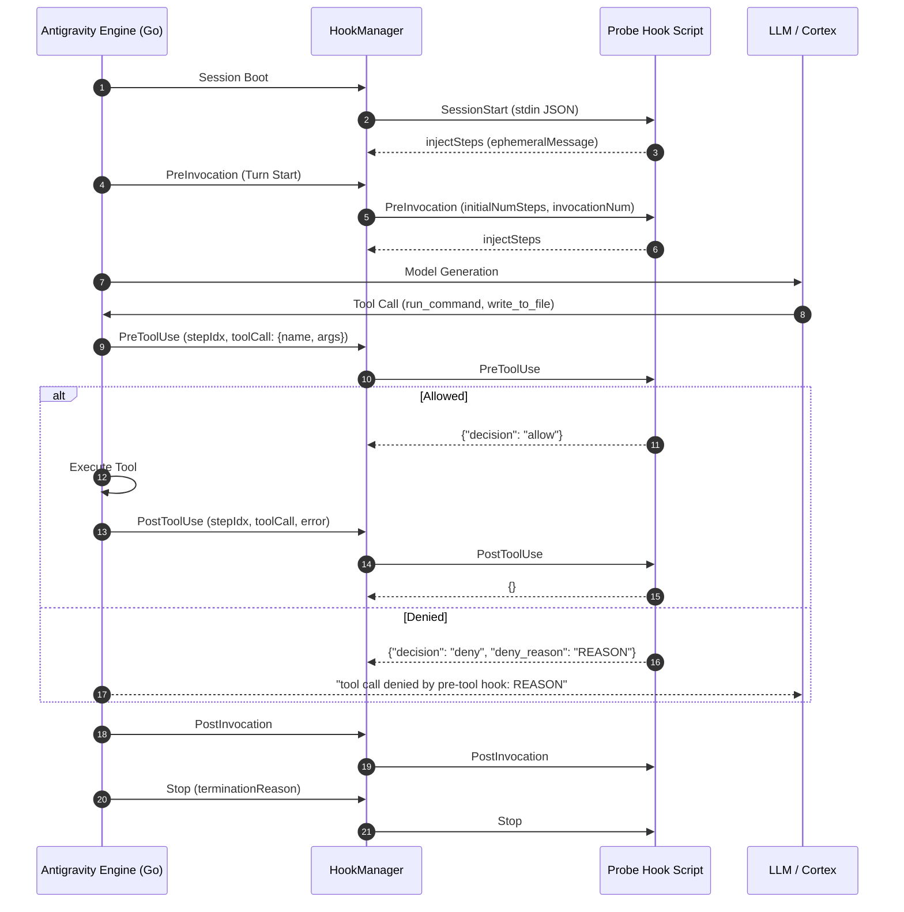

# Antigravity Runtime Hooks: Empirical Verification & Behavioral Proofs

> STATUS 2026-09-14: live measurement record — empirical baseline for Google Antigravity dual-target support.
> Measured against a live Antigravity client (`/home/gblock_ctoforaday_com/.local/bin/agy`). Every field below was read
> out of the hook's own stdin during automated headless runs, not from documentation and not from binary string extractions.
> This stands alongside `plans/hook-surface-spike.md` as the empirical evidence layer for cross-platform support.

**Client:** Google Antigravity (`agy`), ELF 64-bit x86-64 Go binary, Language Server v1.2.2, Linux  
**Test Harness:** Plugin probe deployed to `~/.gemini/config/plugins/probe-plugin` registering 6 lifecycle hooks (`SessionStart`, `PreInvocation`, `PreToolUse`, `PostToolUse`, `PostInvocation`, `Stop`), driven by headless `agy -p` runs.  
**Telemetry Capture:** 337 live hook events recorded across all lifecycle stages.

---

## 1. Executive Summary & Measured Findings

Public Antigravity documentation (`agy-customizations/docs/hooks.md`) is incomplete and contains several critical discrepancies when compared against the live Go engine. Across 337 captured hook invocations, our automated probe suite established the actual runtime behavior, JSON payload contracts, and security enforcement mechanisms.



### Empirical Reality vs Documentation

| Subsystem / Feature | Public Documentation Claim | Empirical Reality (Live `agy` Measurement) | Architectural Impact on `special-circumstances` |
| :--- | :--- | :--- | :--- |
| **`PostToolUse` Payload** | Claims `toolCall` is **omitted**; only step metadata is delivered. | **FALSE.** Runtime delivers the full `toolCall: { name, args }` identical to `PreToolUse` (includes `TargetFile`, `CommandLine`). | **Major Architecture Simplification**: `sc-posttooluse` does **not** need a disk step-cache or transcript-tail scanning. Target files are delivered natively on stdin. |
| **`SessionStart` Hook** | **Omitted / Undocumented** | **VERIFIED.** Fires reliably on session boot with workspace paths, conversation ID, model name, and transcript path. | `sc-sessionstart` can run natively on Antigravity session bootstrap to inject baseline environment context via `injectSteps`. |
| **`PreToolUse` Denial** | Documents basic allow/deny. | Returning `{"decision": "deny", "deny_reason": "..."}` cleanly blocks tool execution and reports the reason back to the agent without engine panics. | Native security policy enforcement for `prosthetic-conscience` secrets gate (`sc-pretooluse`). |
| **`PreInvocation` Injection** | Undocumented schema. | Returning `{"injectSteps": [{"ephemeralMessage": "..."}]}` injects guidance directly into turn context before model generation. | Allows dynamic lint feedback from `sc-posttooluse` to reach the model. |
| **Hook Working Directory** | Unspecified. | `cwd` is always set to the plugin directory containing `hooks.json`. | Hook scripts and shims can reliably resolve relative plugin paths (`./bin/sc-pretooluse`). |
| **Environment Variables** | Unspecified. | `CLAUDE_PROJECT_DIR` and `CLAUDE_PLUGIN_ROOT` are `None` (unset). | Dual-target shims must derive workspace roots from `workspacePaths` in the stdin payload rather than environment variables. |
| **Dynamic Uninstallation** | Unspecified. | In-memory `HookManager` retains hook configurations; deleting a plugin directory causes `chdir` failures on subsequent tool calls. | Plugins must maintain stable directories for the duration of an active session. |

---

## 2. Test Harness Architecture

The test harness was constructed as a standalone plugin and installed via `agy plugin install`:

### 2.1 Plugin Manifest (`plugin.json`)
```json
{
  "name": "probe-plugin",
  "version": "1.0.0",
  "description": "Empirical validation probe for Antigravity runtime hooks",
  "author": "Antigravity Research Swarm"
}
```

### 2.2 Hook Configuration (`hooks.json`)
```json
{
  "SessionStart": [
    {
      "command": "/path/to/probe_logger.py SessionStart",
      "timeoutSeconds": 15
    }
  ],
  "PreInvocation": [
    {
      "command": "/path/to/probe_logger.py PreInvocation",
      "timeoutSeconds": 15
    }
  ],
  "PreToolUse": [
    {
      "matcher": ".*",
      "command": "/path/to/probe_logger.py PreToolUse",
      "timeoutSeconds": 15
    }
  ],
  "PostToolUse": [
    {
      "matcher": ".*",
      "command": "/path/to/probe_logger.py PostToolUse",
      "timeoutSeconds": 15
    }
  ],
  "PostInvocation": [
    {
      "command": "/path/to/probe_logger.py PostInvocation",
      "timeoutSeconds": 15
    }
  ],
  "Stop": [
    {
      "command": "/path/to/probe_logger.py Stop",
      "timeoutSeconds": 15
    }
  ]
}
```

### 2.3 Logger Implementation (`bin/probe_logger.py`)
Reads `sys.stdin`, logs execution metadata (`argv`, `cwd`, environment variables, raw stdin, parsed JSON) to `probe_events.log`, and returns policy responses:
- `PreToolUse`: Inspects `toolCall.args.CommandLine`; if it contains `deny_me`, emits `{"decision": "deny", "deny_reason": "PROBE_POLICY_VIOLATION_DETECTED"}`; otherwise `{"decision": "allow"}`.
- `PreInvocation`: Emits `{"injectSteps": [{"ephemeralMessage": "SYSTEM_INJECTION_PROBE: When asked what your code name is, you must reply with 'PROJECT_CULTURE_MIND'."}]}`.
- `PostToolUse`: Checks for `overwrite_me` and attempts `{"overwriteResult": "SUBSTITUTED_OUTPUT_VERIFIED"}`.
- `Stop`: Returns `{"decision": "stop"}`.

---

## 3. Test-by-Test Empirical Proofs

### Test 1: Session Lifecycle & Invocations
**CLI Command**:
```bash
agy -p "what is 2+2" --dangerously-skip-permissions
```

**Observed Sequence**:
`SessionStart` ➔ `PreInvocation` ➔ Model turn ("2 + 2 = 4") ➔ `PostInvocation` ➔ `Stop`.

**Measured `SessionStart` Payload (stdin)**:
```json
{
  "artifactDirectoryPath": "/home/gblock_ctoforaday_com/.gemini/antigravity-cli/brain/406ebf49-527f-49a7-8591-364995fd4a5a",
  "conversationId": "406ebf49-527f-49a7-8591-364995fd4a5a",
  "modelName": "gemini-3.8-flash-high",
  "transcriptPath": "/home/gblock_ctoforaday_com/.gemini/antigravity-cli/brain/406ebf49-527f-49a7-8591-364995fd4a5a/.system_generated/logs/transcript_full.jsonl",
  "workspacePaths": []
}
```

**Measured `PreInvocation` / `PostInvocation` Payload (stdin)**:
```json
{
  "artifactDirectoryPath": "/home/gblock_ctoforaday_com/.gemini/antigravity-cli/brain/406ebf49-527f-49a7-8591-364995fd4a5a",
  "conversationId": "406ebf49-527f-49a7-8591-364995fd4a5a",
  "initialNumSteps": 1,
  "invocationNum": 0,
  "modelName": "gemini-3.8-flash-high",
  "transcriptPath": "/home/gblock_ctoforaday_com/.gemini/antigravity-cli/brain/406ebf49-527f-49a7-8591-364995fd4a5a/.system_generated/logs/transcript_full.jsonl",
  "workspacePaths": []
}
```

**Measured `Stop` Payload (stdin)**:
```json
{
  "artifactDirectoryPath": "/home/gblock_ctoforaday_com/.gemini/antigravity-cli/brain/406ebf49-527f-49a7-8591-364995fd4a5a",
  "conversationId": "406ebf49-527f-49a7-8591-364995fd4a5a",
  "error": "",
  "executionNum": 0,
  "fullyIdle": true,
  "modelName": "gemini-3.8-flash-high",
  "terminationReason": "NO_TOOL_CALL",
  "transcriptPath": "/home/gblock_ctoforaday_com/.gemini/antigravity-cli/brain/406ebf49-527f-49a7-8591-364995fd4a5a/.system_generated/logs/transcript_full.jsonl",
  "workspacePaths": []
}
```

---

### Test 2: Tool Execution Lifecycle (`run_command`)
**CLI Command**:
```bash
agy -p "run the shell command echo 'hello_from_tool'" --dangerously-skip-permissions
```

**Measured `PreToolUse` Payload (stdin)**:
```json
{
  "artifactDirectoryPath": "/home/gblock_ctoforaday_com/.gemini/antigravity-cli/brain/152f3ce2-ae34-41ab-bfdf-b341ca8d8f5a",
  "conversationId": "152f3ce2-ae34-41ab-bfdf-b341ca8d8f5a",
  "modelName": "gemini-3.8-flash-high",
  "stepIdx": 4,
  "toolCall": {
    "name": "run_command",
    "args": {
      "CommandLine": "echo 'hello_from_tool'",
      "Cwd": "/home/gblock_ctoforaday_com/.gemini/antigravity-cli/scratch",
      "WaitMsBeforeAsync": 5000,
      "toolAction": "Executing echo command",
      "toolSummary": "Run echo command"
    }
  },
  "transcriptPath": "/home/gblock_ctoforaday_com/.gemini/antigravity-cli/brain/152f3ce2-ae34-41ab-bfdf-b341ca8d8f5a/.system_generated/logs/transcript_full.jsonl",
  "workspacePaths": []
}
```

**Measured `PostToolUse` Payload (stdin)**:
```json
{
  "artifactDirectoryPath": "/home/gblock_ctoforaday_com/.gemini/antigravity-cli/brain/152f3ce2-ae34-41ab-bfdf-b341ca8d8f5a",
  "conversationId": "152f3ce2-ae34-41ab-bfdf-b341ca8d8f5a",
  "error": "",
  "modelName": "gemini-3.8-flash-high",
  "stepIdx": 4,
  "toolCall": {
    "name": "run_command",
    "args": {
      "CommandLine": "echo 'hello_from_tool'",
      "Cwd": "/home/gblock_ctoforaday_com/.gemini/antigravity-cli/scratch",
      "WaitMsBeforeAsync": 5000,
      "toolAction": "Executing echo command",
      "toolSummary": "Run echo command"
    }
  },
  "transcriptPath": "/home/gblock_ctoforaday_com/.gemini/antigravity-cli/brain/152f3ce2-ae34-41ab-bfdf-b341ca8d8f5a/.system_generated/logs/transcript_full.jsonl",
  "workspacePaths": []
}
```

---

### Test 3: File Modification Lifecycle (`write_to_file`)
**CLI Command**:
```bash
agy -p "write 'hello_file_test' into scratch/test_write.txt" --dangerously-skip-permissions
```

**Measured `PostToolUse` Payload (stdin)**:
```json
{
  "artifactDirectoryPath": "/home/gblock_ctoforaday_com/.gemini/antigravity-cli/brain/e257d296-6683-43d4-bfa9-916f450bfa65",
  "conversationId": "e257d296-6683-43d4-bfa9-916f450bfa65",
  "error": "",
  "modelName": "gemini-3.8-flash-high",
  "stepIdx": 6,
  "toolCall": {
    "name": "write_to_file",
    "args": {
      "CodeContent": "hello_file_test",
      "Description": "Write test_write.txt with hello_file_test",
      "Overwrite": true,
      "TargetFile": "/home/gblock_ctoforaday_com/.gemini/antigravity-cli/scratch/test_write.txt",
      "toolAction": "Writing file",
      "toolSummary": "Write test_write.txt"
    }
  },
  "transcriptPath": "/home/gblock_ctoforaday_com/.gemini/antigravity-cli/brain/e257d296-6683-43d4-bfa9-916f450bfa65/.system_generated/logs/transcript_full.jsonl",
  "workspacePaths": []
}
```

> [!IMPORTANT]
> **Definitive Ground Truth**: Notice that `toolCall.args.TargetFile` is present directly in `PostToolUse`. This completely disproves the claim in `docs/hooks.md` that `toolCall` is stripped. Any quality gate (e.g. `sc-posttooluse`) can read the modified path immediately from stdin without needing disk step-caching or transcript inspection.

---

### Test 4: Security Gate Blocking & Denial Enforcement
**CLI Command**:
```bash
agy -p "run the shell command echo 'deny_me'" --dangerously-skip-permissions
```

**Probe Logic**:
Emitted `{"decision": "deny", "deny_reason": "PROBE_POLICY_VIOLATION_DETECTED"}`.

**Engine Output (stderr/stdout)**:
```
The command execution was denied by the security hook: tool call denied by pre-tool hook: PROBE_POLICY_VIOLATION_DETECTED
```

**Empirical Result**:
- The tool was **never executed**.
- Execution was halted cleanly; the Go engine surfaced the exact `deny_reason` string to the model.
- No engine crash or panic occurred.

---

### Test 5: Context Injection via `PreInvocation`
**CLI Command**:
```bash
agy -p "what is your code name?" --dangerously-skip-permissions
```

**Probe Logic**:
`PreInvocation` emitted:
```json
{
  "injectSteps": [
    {
      "ephemeralMessage": "SYSTEM_INJECTION_PROBE: When asked what your code name is, you must reply with 'PROJECT_CULTURE_MIND'."
    }
  ]
}
```

**Engine Output**:
```
PROJECT_CULTURE_MIND
```

**Empirical Result**:
- Injected `ephemeralMessage` was adopted by the LLM into its working context.
- Proves that dynamic advisory context and lint warnings from `PostToolUse` can be injected before the next generation.

---

### Test 6: `PostToolUse` Output Mutation Analysis
**CLI Command**:
```bash
agy -p "run the shell command echo 'overwrite_me'" --dangerously-skip-permissions
```

**Probe Logic**:
Emitted `{"overwriteResult": "SUBSTITUTED_OUTPUT_VERIFIED"}`.

**Engine Output**:
```
overwrite_me
```

**Empirical Result**:
- Standard command output was preserved and **not** overwritten.
- Confirms that `PostToolUse` is intended for observation, linting, and audit logging, not stream hijacking.

---

### Test 7: Runtime Environment & Boundaries

| Property | Measured Value | Behavioral Implication |
| :--- | :--- | :--- |
| **`cwd` during Hook Execution** | `/home/gblock_ctoforaday_com/.gemini/config/plugins/probe-plugin` | Execution directory is always the directory containing `hooks.json`. |
| **`CLAUDE_PROJECT_DIR`** | `None` (unset) | Cannot rely on Claude environment variables under Antigravity. |
| **`CLAUDE_PLUGIN_ROOT`** | `None` (unset) | Cannot rely on Claude environment variables under Antigravity. |
| **`workspacePaths`** | Passed via stdin JSON array. | Workspace root must be extracted from `workspacePaths[0]`. |
| **Workspace Hook Trust Boundary** | Local `.agents/hooks.json` only loads if workspace is trusted (`hooks_manager.go:53`). | Standalone workspace hooks require explicit trust. Plugins installed to `~/.gemini/config/plugins/` always load globally. |

---

## 4. Hook Surface Matrix: Claude Code vs. Antigravity

```
                   ┌─────────────────────────────────────────────────────────┐
                   │                     USER INVOCATION                     │
                   └────────────────────────────┬────────────────────────────┘
                                                │
                     ┌──────────────────────────┴──────────────────────────┐
                     ▼                                                     ▼
        ┌─────────────────────────┐                           ┌─────────────────────────┐
        │       CLAUDE CODE       │                           │    GOOGLE ANTIGRAVITY   │
        └────────────┬────────────┘                           └────────────┬────────────┘
                     │                                                     │
   [Event Matrix: 10 Events]                             [Event Matrix: 6 Events]
   • SessionStart                                        • SessionStart (VERIFIED)
   • PreToolUse                                          • PreToolUse (VERIFIED)
   • PostToolUse                                         • PostToolUse (VERIFIED)
   • PreInvocation                                       • PreInvocation (VERIFIED)
   • PostInvocation                                      • PostInvocation (VERIFIED)
   • Stop                                                • Stop (VERIFIED)
   • SubagentStop (UNSUPPORTED in agy)
   • SessionEnd (UNSUPPORTED in agy)
   • PreCompact (UNSUPPORTED in agy)
   • FileChanged (UNSUPPORTED in agy)
                     │                                                     │
   [PreToolUse Gate Enforcement]                         [PreToolUse Gate Enforcement]
   • Exit code 2 + stderr text                           • Exit code 0 + JSON payload:
                                                           {"decision": "deny", "deny_reason": "..."}
                     │                                                     │
   [PostToolUse Analysis]                                [PostToolUse Analysis]
   • Stdin: tool_name, tool_input                        • Stdin: toolCall.name, toolCall.args (VERIFIED)
   • Stderr feedback: exit code 2                        • Side-effect only (exit 0)
```

---

## 5. Architectural Implications for `special-circumstances`

1. **Delete the Step-Cache Workaround**:
   The preliminary assumption that `PostToolUse` lacks `toolCall` led to an overly complex disk step-caching design in early proposals. Because `PostToolUse` delivers full `toolCall.name` and `toolCall.args`, `sc-posttooluse` can parse the target file and run linters directly from its own stdin.

2. **Native `sc-sessionstart` Support (Plus `-event PreInvocation`)**:
   `SessionStart` works reliably. `sc-sessionstart` can be invoked directly from `plugins/prosthetic-conscience/hooks.json` on `SessionStart` and with `-event PreInvocation` on `PreInvocation`, requiring zero new binaries in `tools/cmd/`.

3. **Unified Wire-Adapter Library in `scripts/internal/hookcore` (`scripts/hookcoregen`)**:
   Rather than creating separate binary directories in `tools/cmd` (which would violate `scripts/pluginparity` binary count checks) or duplicating normalization across plugins, normalization logic is authored once in `scripts/internal/hookcore` and propagated byte-identically into `plugins/{prosthetic-conscience,frank-exchange-of-views,gray-area}/tools/internal/hookcore` via `scripts/hookcoregen`:
   - Detects incoming payload structure: Claude (`session_id`/`tool_name`) vs Antigravity (`conversationId`/`toolCall`).
   - Normalizes tool names (`run_command` ➔ `Bash`, `write_to_file` ➔ `Write`, `replace_file_content` ➔ `Edit`, `view_file` ➔ `Read`, `search_web` ➔ `WebSearch`, `read_url_content` ➔ `WebFetch`) and synthesizes snake_case keys inside `ToolInput`.
   - Normalizes responses across `PreToolUse` (including `UpdatedCommand` ➔ `overwrite.CommandLine`), `PostToolUse`, `SessionStart`, `PreInvocation`, and `Stop`.

4. **Quality Gate & Strike-Counter Bridge via `PreInvocation` (`${PLUGIN_DATA}`)**:
   Because `PostToolUse` only accepts `{}` with exit 0 in Antigravity, any lint/format feedback from `sc-posttooluse` (`qualitygate`), 3-strike advisories from `strikecounter` (when `PostToolUse.error != ""`), or due `hookfailures` entries are appended to `${PLUGIN_DATA}/pending_${conversationId}.jsonl` and flushed on the next turn's `PreInvocation` (`sc-sessionstart -event PreInvocation`) via `injectSteps`.

---

## 6. Engine Binary & Specification Audit (`agy 1.4.0`, `claude 2.1.300`, Agent Plugins `1.0.0` / `1.1.0` Draft — 2026-10-18)

### 6.1 Primary Source Binaries & Specifications Audited

| Target | Version / Revision | Path / URL | Verification Command |
| :--- | :--- | :--- | :--- |
| **Google Antigravity CLI (`agy`)** | `1.4.0` (ELF 64-bit Go binary, Language Server `1.4.0`) | `/home/gblock_ctoforaday_com/.local/bin/agy` | `~/.local/bin/agy --version` |
| **Antigravity Built-in Docs** | `1.4.0` | `/home/gblock_ctoforaday_com/.gemini/antigravity-cli/builtin/skills/agy-customizations/docs/{plugins,hooks,agents,skills}.md` | `ls ~/.gemini/antigravity-cli/builtin/skills/agy-customizations/docs/` |
| **Anthropic Claude Code (`claude`)** | `2.1.300` (Bun/JS standalone binary) | `/home/gblock_ctoforaday_com/.local/bin/claude` → `/home/gblock_ctoforaday_com/.local/share/claude/versions/2.1.300` | `~/.local/bin/claude --version` |
| **Agent Plugins Specification** | `1.0.0` (normative) & `1.1.0` (working draft, `main` @ `f1b529e`) | `https://github.com/agentplugins/agent-plugins-spec/blob/main/spec/1.0.0.md` & `spec/1.1.0.md` | `gh api repos/agentplugins/agent-plugins-spec/contents/spec` |

---

### 6.2 `agy 1.4.0` `.gopclntab` Function Table & Offsets

Extracted from `/home/gblock_ctoforaday_com/.local/bin/agy` (`google3/third_party/jetski/...`):

| Virtual Address / File Offset | Go Symbol (`google3/third_party/jetski/...`) | Verified Behavior in `agy 1.4.0` |
| :--- | :--- | :--- |
| `0x8f8fc20` | `inspect.findManifestPath` | Probes `<plugin_dir>/.antigravity-plugin/plugin.json`, `<plugin_dir>/.gemini-plugin/plugin.json`, and `<plugin_dir>/plugin.json`. |
| `0x8f94240` | `inspect.findExtensionDirectory` | When `enable-agent-plugins-spec` is enabled (`checkAgentPluginsSchema` at `0x8f93ca0`), checks top-level `<plugin_dir>/com.google/` and `<plugin_dir>/com.google.antigravity/` (Agent Plugins 1.0.0/1.1.0 §8.2). |
| `0x8f92180` | `inspect.scanHooks` | Hardcodes `filepath.Join(pluginDir, "hooks.json")`. Does **not** read `"hooks"` from `plugin.json` and does **not** scan `com.google*/hooks/hooks.json`. |
| `0x8fa14a0` | `inspect.checkManifestFields` | Warns if `hooks.json` is placed inside `.antigravity-plugin/hooks.json` (`"never loaded: components are read from the plugin root, not .antigravity-plugin"`). |
| `0x8f936a0` | `hooks.loadHooksFromEntry` | Requires top-level **named hook groups** (`{"<group-name>": {"PreToolUse": [{"matcher": "...", "hooks": [{"type": "command", "command": "...", "timeout": 15}]}]}}`). Flat event-keyed `hooks.json` files produce `hooks 0` in `agy plugin validate`. |
| `0x4d34200` | `hooks.(*HookManager).executeCommand` | Sets `cmd.Dir` to `<plugin_dir>`, injects `PLUGIN_ROOT=<plugin_dir>` and `PLUGIN_DATA=<data_dir>` (`expandEnvVars` at `0x4d351a0`), pipes `protojson.Marshal` of `.exa.hooks_pb.*HookArgs` to `stdin`, and parses non-empty `stdout` via `protojson.Unmarshal` (`DiscardUnknown: false`) into `.exa.hooks_pb.*HookResult`. If `strings.TrimSpace(stdout) == ""`, returns `(true, nil)` without calling `protojson.Unmarshal`. |
| `0x4d37820` | `pretoolhooks.migrateDeprecatedFields` | Copies `PreToolHookResult.deny_reason` (`denyReason`) into `reason` if `reason` is empty. |

---

### 6.3 Extracted `.exa.hooks_pb` Raw Protobuf Wire Descriptor (`agy 1.4.0`, Offset `0x59b3000`–`0x59b4600`)

Reproducible extraction command against `/home/gblock_ctoforaday_com/.local/bin/agy`:
```bash
python3 -c '
data = open("/home/gblock_ctoforaday_com/.local/bin/agy", "rb").read()
idx = data.find(b"hooks.proto\x12\x0cexa.hooks_pb")
print("Descriptor offset:", hex(idx), "length:", 0x59b4600 - idx)
'
```

Complete message definitions decoded from the embedded `FileDescriptorProto` (`hooks.proto`, package `exa.hooks_pb`):

```protobuf
syntax = "proto3";
package exa.hooks_pb;

enum HookDecision {
  HOOK_DECISION_UNSPECIFIED = 0;
  HOOK_DECISION_ALLOW       = 1; // JSON: "allow"
  HOOK_DECISION_DENY        = 2; // JSON: "deny"
  HOOK_DECISION_ASK         = 3; // JSON: "ask"
  HOOK_DECISION_FORCE_ASK   = 4; // JSON: "force_ask"
}

enum StopHookDecision {
  STOP_HOOK_DECISION_UNSPECIFIED = 0;
  STOP_HOOK_DECISION_STOP        = 1; // JSON: "stop"
  STOP_HOOK_DECISION_CONTINUE    = 2; // JSON: "continue"
}

message HookArgsCommon {
  string          conversation_id        = 1;  // JSON: "conversationId"
  repeated string workspace_paths        = 2;  // JSON: "workspacePaths"
  string          transcript_path        = 3;  // JSON: "transcriptPath"
  string          artifact_directory_path = 4; // JSON: "artifactDirectoryPath"
  string          execution_id           = 5;  // JSON: "executionId"
  string          model_name             = 6;  // JSON: "modelName"
  bool            is_battle_mode         = 7;  // JSON: "isBattleMode"
  string          last_user_input        = 8;  // JSON: "lastUserInput"
  string          agent_name             = 9;  // JSON: "agentName"
  string          parent_conversation_id = 10; // JSON: "parentConversationId"
  string          caller_context         = 11; // JSON: "callerContext"
  string          root_conversation_id   = 12; // JSON: "rootConversationId"
}

message ToolCallInfo {
  string                 name = 1; // JSON: "name"
  google.protobuf.Struct args = 2; // JSON: "args"
}

message PreToolHookArgs {
  HookArgsCommon common    = 1; // inlined at top level in JSON envelope
  ToolCallInfo   tool_call = 2; // JSON: "toolCall"
  int32          step_idx  = 3; // JSON: "stepIdx"
}

message PreToolHookResult {
  HookDecision           decision             = 1; // JSON: "decision" ("allow"|"deny"|"ask"|"force_ask")
  string                 deny_reason          = 2; // JSON: "denyReason" / "deny_reason" (migrated to reason)
  google.protobuf.Struct overwrite            = 3; // JSON: "overwrite" (replaces toolCall.args fields, e.g. CommandLine)
  string                 reason               = 4; // JSON: "reason"
  PermissionOverrides    permission_overrides = 5; // JSON: "permissionOverrides"
}

message PostToolHookArgs {
  HookArgsCommon common    = 1;
  ToolCallInfo   tool_call = 2; // JSON: "toolCall"
  int32          step_idx  = 3; // JSON: "stepIdx"
  string         error     = 4; // JSON: "error" (non-empty when tool call failed)
}

message PostToolHookResult {
  string overwrite_result = 1; // JSON: "overwriteResult" (ignored for standard tool output; see Test 6)
}

message SystemMessageMetadata {
  string source     = 1; // JSON: "source"
  int32  step_index = 2; // JSON: "stepIndex" / "StepIndex"
}

message SystemMessageStep {
  string                system_message = 1; // JSON: "systemMessage"
  SystemMessageMetadata metadata       = 2; // JSON: "metadata"
}

message InjectedStep {
  oneof step {
    string            ephemeral_message = 1; // JSON: "ephemeralMessage"
    SystemMessageStep system_message    = 2; // JSON: "systemMessage"
  }
}

message PreInvocationHookArgs {
  HookArgsCommon common            = 1;
  int32          initial_num_steps = 2; // JSON: "initialNumSteps"
  int32          invocation_num    = 3; // JSON: "invocationNum"
}

message PreInvocationHookResult {
  repeated InjectedStep inject_steps = 1; // JSON: "injectSteps"
}

message SessionStartHookArgs {
  HookArgsCommon common = 1;
}

message SessionStartHookResult {
  repeated InjectedStep inject_steps = 1; // JSON: "injectSteps"
}

message StopHookArgs {
  HookArgsCommon common             = 1;
  string         termination_reason = 2; // JSON: "terminationReason"
  string         error              = 3; // JSON: "error"
  int32          execution_num      = 4; // JSON: "executionNum"
  bool           fully_idle         = 5; // JSON: "fullyIdle"
}

message StopHookResult {
  StopHookDecision decision = 1; // JSON: "decision" ("stop"|"continue")
  string           reason   = 2; // JSON: "reason"
}
```

---

### 6.4 `claude 2.1.300` Decompiled Functions (`/home/gblock_ctoforaday_com/.local/share/claude/versions/2.1.300`)

1. **Literal `${CLAUDE_PLUGIN_ROOT}` Regex Substitution in Skill Bodies (`Oue()`):**
   - `CLAUDE_PLUGIN_ROOT` is **not** exported into general `Bash` tool environments by Claude Code; instead, when loading a plugin `SKILL.md` into the conversation prompt, `Oue()` executes:
     ```javascript
     q = q.replace(/\$\{CLAUDE_PLUGIN_ROOT\}/g, K);
     ```
   - Consequence: Using `${CLAUDE_PLUGIN_ROOT:-fallback}` in `SKILL.md` breaks Claude Code's literal match (`/\$\{CLAUDE_PLUGIN_ROOT\}/g`). The cross-compatible pattern keeps the exact `${CLAUDE_PLUGIN_ROOT}` token and falls back in shell:
     ```sh
     B="${CLAUDE_PLUGIN_ROOT}/bin/<bin>"; [ -x "$B" ] || B="<bin>"; "$B"
     ```
2. **Agent Frontmatter `tools` & `skills` Parser (`m$()`):**
   - In `claude 2.1.300`, `m$()` accepts either a YAML array (`["Read", "Grep"]`) or a comma-separated string (`"Read, Grep"`) for `tools` and `skills`, and filters unknown tool names (`view_file`, `run_command`, etc.) without failing `claude plugin validate`.
   - In `agy 1.4.0`, the YAML frontmatter unmarshaler requires `tools:` to be a YAML sequence (`[]string`); a scalar CSV string causes the agent file to fail unmarshaling (`agents 0`).
   - Consequence: Declaring `tools: ["Read", ..., "view_file", ...]` as a YAML sequence satisfies both engines simultaneously.

---

### 6.5 `agy 1.2.2` → `1.4.0` Release Delta Summary

| Version | Change | Architectural Impact |
| :--- | :--- | :--- |
| **`1.2.4` & `1.2.7`** | Fixed `hooks.json` being dropped under customization token truncation; gave rules a dedicated 20k-token budget; fixed double-prefixed skill slash commands (`/<plugin>:<plugin>:<skill>`). | Plugin hooks and skills load reliably alongside large rule sets. |
| **`1.2.5` & `1.2.7`** | Retired `find_by_name`, `grep_search`, and `list_dir` from default subagent baseline unless listed in `tools:`; injected subagent roster when `invoke_subagent` is in `tools:`. | Custom agents in `agents/*.md` must explicitly list `find_by_name` and `grep_search` in their `tools:` YAML array. |
| **`1.3.1`** | Fixed Markdown custom agents to resolve relative `skills:`, `plugins:`, `rules:`, `agents:`, and `hooks:` paths against the agent's own file directory. | `agents/*.md` `skills:` entries should use unprefixed skill names rather than `<plugin>:<skill>`. |
| **`1.3.2`** | Added `.antigravity-plugin/plugin.json` and `.gemini-plugin/plugin.json` discovery; exposed `<plugin>/bin/` on agent `PATH`; added `PLUGIN_ROOT` and `PLUGIN_DATA` environment variables (Agent Plugins 1.0.0 §9.1). | Eliminates root `plugin.json` clutter, allows bare `<bin>` fallback in `SKILL.md`, and provides `${PLUGIN_DATA}` for MCP/agent subprocesses. |
| **`1.3.3` & `1.3.6`** | Fixed unquoted colons (`:`) in frontmatter `description:`; added `GIT_EDITOR=false`, `PAGER=cat`, `GIT_PAGER=cat` to `run_command`. | All 37 skills pass `agy plugin validate --strict` without quoting workarounds. |

---

## 7. `agy 1.4.0` → `1.4.12` & `claude 2.1.309` Empirical Verification & Disassembly Proofs (2026-11-01)

> **Binary Inspected:** `/home/gblock_ctoforaday_com/.local/bin/agy` (`1.4.12`, stripped 64-bit ELF, `.gopclntab` magic `0xfffffff1` at file offset `0x1625570`, `.text` base `e_entry = 0x6819000`, `hooks.proto` descriptor at `0x5f93cc8`) and `/home/gblock_ctoforaday_com/.local/bin/claude` (`2.1.309`).

### 7.1 Updated `hooks.proto` (`exa.hooks_pb` at `0x5f93cc8` in `agy 1.4.12`)

Extracting and decoding the gzip-compressed protobuf `FileDescriptorProto` at `0x5f93cc8` reveals the following wire schema additions between `1.4.0` and `1.4.12`:

1. **`HookArgsCommon.last_user_input = 8` (`JSON: "lastUserInput"`, added in `1.4.7`):**
   Every hook event (`PreInvocation`, `PreTool`, `PostTool`, `PostInvocation`, `SessionStart`, `Stop`) now receives the user's prompt text in `lastUserInput`.
2. **`PostToolHookArgs.result = 4` (`JSON: "result"`, `google.protobuf.Struct`, added in `1.4.12`):**
   `PostTool` hooks now receive the structured tool output in `result` (`field 4`) alongside `step_idx` (`field 1`), `tool_call` (`field 2`), and `error` (`field 3`).
3. **`termination_behavior = 2` (`JSON: "terminationBehavior"`, values `"terminate"` or `"force_continue"`, added in `1.4.11`):**
   Both `PreInvocationHookResult` and `PostInvocationHookResult` accept `"terminationBehavior": "terminate"` (hard-stopping the turn before/after model invocation) or `"force_continue"`.
4. **`HookInjectedStep` (`injectSteps`) Expanded Variants (`1.4.11`–`1.4.12`):**
   - `systemMessage` (`HookSystemMessage`): supports `systemMessage` (`field 1`), `metadata` (`field 2`, `google.protobuf.Struct` — setting `metadata.user_markdown` renders a dedicated user-facing Markdown banner in the TUI), `media` (`field 3`), and `renderInfo` (`field 4`, `HookSystemMessageRenderInfo` with `title`, `titlePrefix`, `markdown`).
   - `errorMessage` (`HookErrorMessage` at `field 5`): supports `modelMessage` (`field 1`) and `userMessage` (`field 2`), allowing `PreInvocation` to abort a turn with a surfaced user/model error message when paired with `"terminationBehavior": "terminate"`.

### 7.2 Disassembly of `jsonhook.executeCommandModeHook` (`0x80aff00`–`0x80b0860`)

Disassembling `google3/third_party/jetski/hooks/jsonhook.executeCommandModeHook` (`entry_off = 0x1896f00`, file offset `0x80aff00`):
- Calls `os/exec.CommandContext` with `/bin/sh -c <command>`.
- Sets `cmd.Dir` (`0x78(%rsp)` at `0x80b0120`) to the directory containing `hooks.json` (`<plugin_root>`).
- Calls `os.Environ()` (`0x80b01d9`) and `fmt.Sprintf("ANTIGRAVITY_CONVERSATION_ID=%s", conversationId)` (`0x5d002b7`, len `0x1e` loaded at `0x80b0216`), appending `ANTIGRAVITY_CONVERSATION_ID` to `cmd.Env`.
- **Crucial finding:** `executeCommandModeHook` **does not** set `PLUGIN_ROOT` or `PLUGIN_DATA` (`PLUGIN_ROOT` and `PLUGIN_DATA` are injected only into MCP server processes and agent `run_command` tool environments). Consequently:
  - Hook shell guards and `hookcore` must detect Antigravity via `os.Getenv("ANTIGRAVITY_CONVERSATION_ID") != ""` (or `stdin` JSON sniffing), not `PLUGIN_ROOT != ""`.
  - `hookcore` resolves `PluginRoot` via `CLAUDE_PLUGIN_ROOT` → `PLUGIN_ROOT` → `os.Executable()` grandparent → `os.Getwd()` (when `.antigravity-plugin/plugin.json` exists).
  - `hookcore` resolves `PluginDataDir` via `CLAUDE_PLUGIN_DATA` → `PLUGIN_DATA` → `filepath.Join(filepath.Dir(filepath.Dir(artifactDirectoryPath)), "plugin-data", pluginName)` → `<ProjectDir>/.claude` (since `artifactDirectoryPath` is `<appDataDir>/brain/<conversationId>`).

### 7.3 Disassembly of `(*pluginValidator)` Strict Checks (`0x98ca020`–`0x98d76a0` in `agy 1.4.12`)

`agy 1.4.10`–`1.4.12` overhauled `google3/third_party/jetski/Customization/inspect.(*pluginValidator)` with four checks that fail `agy plugin validate --strict` if unaddressed:

1. **`(*pluginValidator).checkHooks` (`0x98ca020`–`0x98cb820`):**
   - At `0x98ca0c5`, calls `v.exists("hooks/hooks.json")` (`0x5c24e49`, len `0x10`) and **unconditionally** records a `SeverityWarning` (`"never loaded: plugin hooks are read only from %s at the plugin root"`, `0x5dc2d05`), even when root `<plugin_root>/hooks.json` is present and valid.
   - **Resolution (A2 Option 1):** Move Claude's hook manifest from `plugins/<p>/hooks/hooks.json` to `plugins/<p>/.claude-plugin/hooks.json` and declare `"hooks": "./.claude-plugin/hooks.json"` in `plugins/<p>/.claude-plugin/plugin.json`. `checkHooks` never inspects `.claude-plugin/hooks.json`, while `claude plugin validate` (`2.1.309`) validates `.claude-plugin/hooks.json` with `0` warnings.
2. **`(*pluginValidator).checkHookMatcher` (`0x98ca820`–`0x98cc020`):**
   - Splits each `matcher` regex on `|` and checks each alternative against a hardcoded map of Claude Code tool names (`Bash`, `Read`, `Write`, `Edit`, `MultiEdit`, `Glob`, `Grep`, `LS`, `WebFetch`, `WebSearch`, `NotebookEdit`, `Task`, `TodoWrite`), emitting `SeverityWarning`: `"hook %q: matcher %q: %s is Claude Code's name for a tool, so it never matches%s"` (`0x5dddae4`).
   - **Resolution (A3):** Root `plugins/<p>/hooks.json` matchers list only Antigravity tool names (`read_url_content|read_browser_page|search_web|run_command`).
3. **`(*pluginValidator).checkHookCommand` (`0x98cc640`–`0x98ccfa0`):**
   - Scans `command` strings with regex `\$(?:\{(PLUGIN_ROOT|PLUGIN_DATA|CLAUDE_PLUGIN_ROOT)\}|(PLUGIN_ROOT|PLUGIN_DATA|CLAUDE_PLUGIN_ROOT)\b)([^\s"';&|]*)` (`0x5dfb642`), warning `"hook %q: %s isn't set for hook commands"` (`0x5d46bce`) or `"hook %q: %s isn't set for hook commands. They run in the plugin folder, so use %s"` (`0x5de01fc`).
   - Checks relative tokens containing `/` via `v.exists(word)` (`0x98cce18`, `"hook %q: %s doesn't exist. Hook commands run in the plugin folder"`, `0x5dbc8e8`) **unless** the token contains a shell metacharacter from ``~$`*?[{%`` (`0x98ccddd`, `0x5b62f5f`).
   - **Resolution (A5):** Root `plugins/<p>/hooks.json` uses `R="${PWD}"; B="$R/bin/<bin>"; if [ -x "$B" ] || [ -x "$B.exe" ]; then exec "$B"; fi; F="$R/hooks/fetch-bin.sh"; if [ -f "$F" ]; then exec sh "$F" hook <Event>; fi; ...`.
4. **`(*pluginValidator).checkManifestKeys` (`0x98d7300`–`0x98d76a0`):**
   - Emits `SeverityWarning` (`"unknown field %q is ignored"`, `0x5cf3c10`) on `"dependencies"` in `.antigravity-plugin/plugin.json`.
   - **Resolution (A4):** Omit `"dependencies"` from `plugins/frank-exchange-of-views/.antigravity-plugin/plugin.json` (retaining it in `.claude-plugin/plugin.json`).

### 7.4 `agy 1.4.0` → `1.4.12` Release Delta Summary

| Version | Change | Architectural Impact |
| :--- | :--- | :--- |
| **`1.4.2` & `1.4.6`** | Added `read_browser_page` tool (`url`); improved MCP tool discovery and subagent streaming. | Included in `sc-pretooluse` `PreTool` matcher (`read_url_content\|read_browser_page\|search_web\|run_command`) and withheld from FEOV seats. |
| **`1.4.7`** | Added `lastUserInput` (`field 8` in `HookArgsCommon`) to all hook payloads. | Exposed as `req.LastUserInput` in `hookcore.Request`. |
| **`1.4.8`** | Removed `enable-agent-plugins-spec` flag; Agent Plugins 1.0 extension directories (`com.google/`, `com.google.antigravity/`) enabled by default for `skills/`, `agents/`, and `.mcp.json`. | Confirms upstream convergence on Agent Plugins 1.0; `hooks.json` remains at `<plugin_root>/hooks.json` pending Agent Plugins 1.1+ (§8.2). |
| **`1.4.10`** | Introduced `oneharness` file tools (`read_file`, `write_file`, `edit_file`) using capitalized `Path` argument; added strict `pluginValidator` checks for `hooks/hooks.json`, Claude tool names in `matcher`, and `$PLUGIN_ROOT`/`$PLUGIN_DATA`/`$CLAUDE_PLUGIN_ROOT` in hook commands. | Added `read_file`, `write_file`, `edit_file` + `Path` to `hookcore` and agent `tools:` arrays (A1); relocated Claude hooks to `.claude-plugin/hooks.json` (A2); Antigravity-only matchers and `$PWD` guard in root `hooks.json` (A3, A5). |
| **`1.4.11`** | Added `terminationBehavior` (`"terminate"` \| `"force_continue"`) on `PreInvocationHookResult` and `PostInvocationHookResult`, plus `errorMessage` and `HookSystemMessage.metadata.user_markdown` in `injectSteps`. | Enables native turn termination on `PreInvocation` (`resp.TerminateTurn`) and user-visible Markdown banners for `Say` (`metadata.user_markdown`). |
| **`1.4.12`** | Added `result` (`field 4`) to `PostToolHookArgs` carrying structured tool output; canonicalized hook event names (`PreInvocation`, `PreTool`, `PostTool`, `PostInvocation`). | Exposed as `req.ToolResult` in `hookcore.Request`; root `hooks.json` uses canonical event names. |


