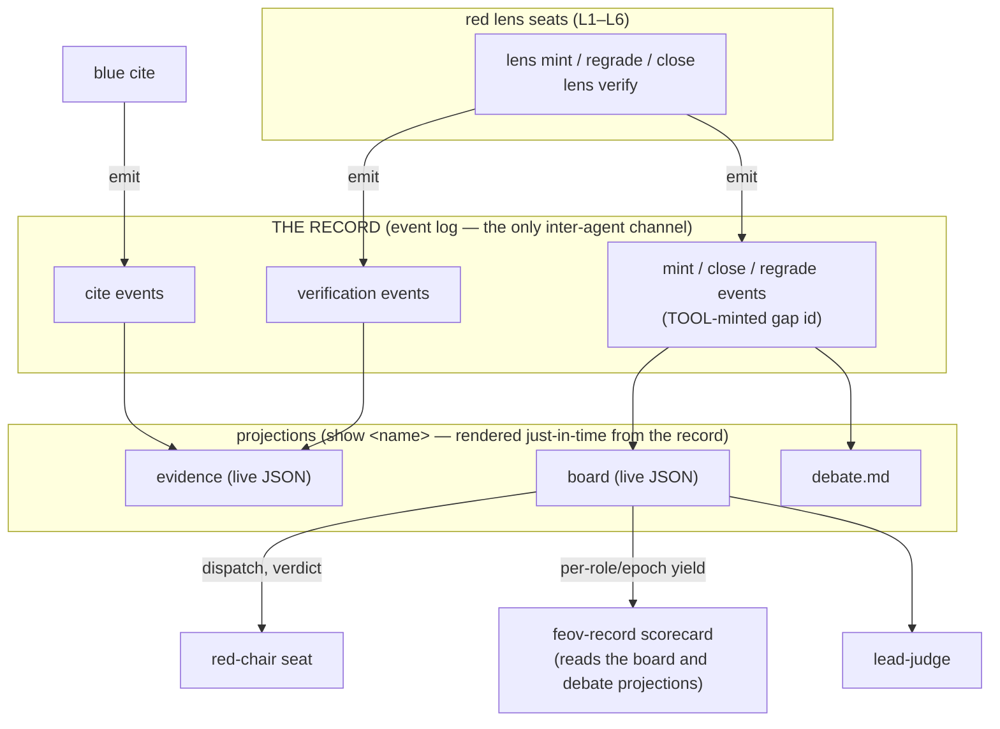

# The record flow — event → record → views → seats

The canonical channel between seats is the **record** (the append-only event log, written
only through `feov-record`). Non-prose actions — gaps, readings, citations, closures,
motions, opinions — are events; the markdown files are *projections* of the record for a
human reading afterward, never the channel. This diagram is kept current with the code
([[fuzzers-and-diagrams-track-code]]); update it in the same PR as any record/protocol change.

## A wrong act

An act stands as filed, and a seat answers a wrong one with another act — which act is one table,
`superseders` in `internal/record/supersede.go`, rendered on each recording verb's help page and on
the refusal of a second act where a sitting holds one. Nothing is edited, and every view reads every
act. A record from before epoch 27 may hold same-sitting corrections; `feov-migrate` writes each chain as
its last replacement, in the place the chain began, and writes nothing for its later links.

## Gaps & citations onto the record (#62 pt1, #70/#71)

## Invariants the diagram encodes

- **A lens reports a defect one way: it mints a gap.** `feov-record mint` records it; the tool mints
  the gap's id, and the lens's area prints beside it wherever it is named. One open gap per class
  stands on a sentence, inquiry or citation: a second mint is refused, naming the gap that stands. A
  lens that disputes that gap proposes the act it wants on it — a regrade or a close —
  argued in its reason; the gap's lens may accept it, else the bench rules. Agreeing with a gap is no
  act.
- **The chair mints nothing.** It reads the board to dispatch and to decide the verdict; a gap is its
  lens's from mint to close.
- **Two readers of one replay never drift.** `viewjson.go` (the live JSON views) and
  `internal/view` (the markdown projections, rendered just-in-time on read) both derive from
  `BoardState`; neither parses the other's output, and neither materializes to disk.
- **A regrade that keeps the grade is a lens's statement that its gap stands.** It moves nothing on
  the board and counts as an exchange that moved nothing; its reason reaches blue's work list beside
  the gap (until blue answers again) and debate.md as `### RED KEEPS THE GRADE`, which the bench reads.
- **citations_checked** is the board's `counts.citations` (a tally of `cite` events), not a
  self-report (#70/#71 — the citation half of this same migration).

## The bibliography core — fetch → cache → cite → weave

Citations are tool-managed end to end, and the whole path — fetch, the run cache, `cite`, red's
checks, and assembly into notes and a Bibliography — has its own page, with the known faults of each
step: **[citations-and-bibliography.md](citations-and-bibliography.md)**. What this flow depends on:

- **A citation is a record event, and its marker is an insert op.** `cite` records the event and a
  marker insertion at the quoted sentence; the report is the lanes' parts plus the replayed ops, so
  there is no file to splice and no torn-splice window.
- **Every `<!--cite:-->` anchor in the report is a cite event's, by construction:** the report is
  replayed from the record and places only recorded markers. `blue edit` refuses a rewrite that drops
  or splits an anchor of any kind; a cut of whole sentences takes their anchors and lists them on the
  edit (`removed_anchors`), and a retire names the one it takes, so a cite event's anchor is in the
  report until an act names it out.
- **The claim unit is the evidence anchor, a citation or a computation** — `count-claims` counts
  one claim per distinct evidence anchor per sentence; nothing counts the assembled report.

## Out of scope (separate concepts)

`blue/candidates/<lane>.md` is where a lane writes its part before `ingest` records it and removes the file. `#62 pt2`
(de-editorialising the chair via `supersedes`/tool-side dedup) is a later change.
